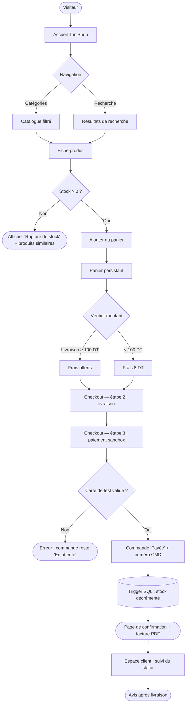
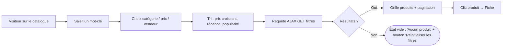
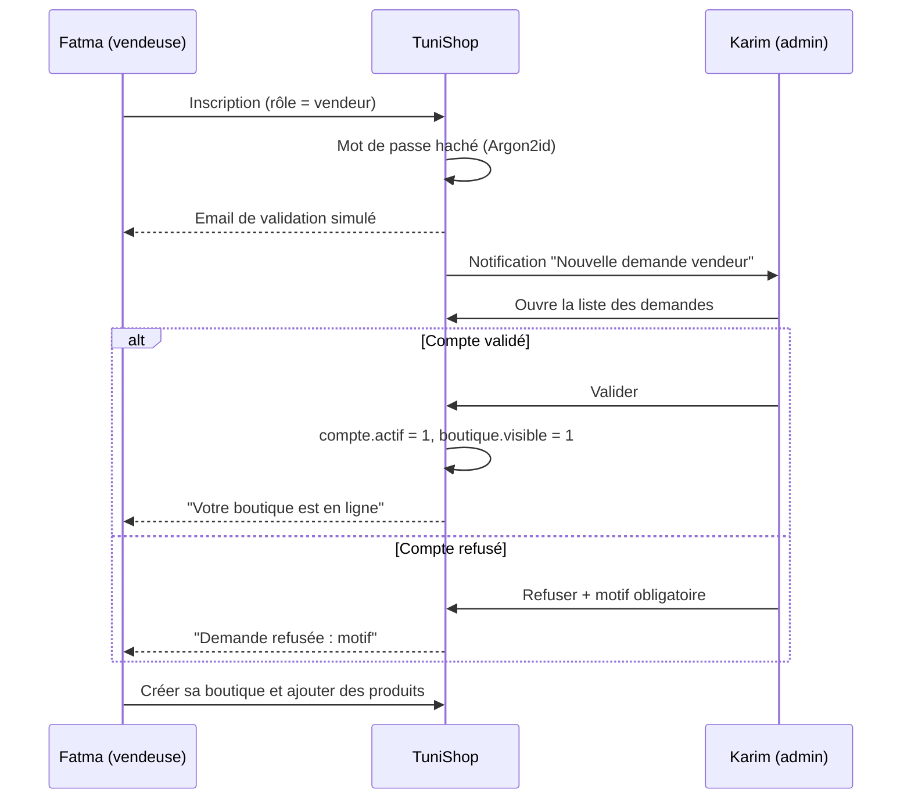
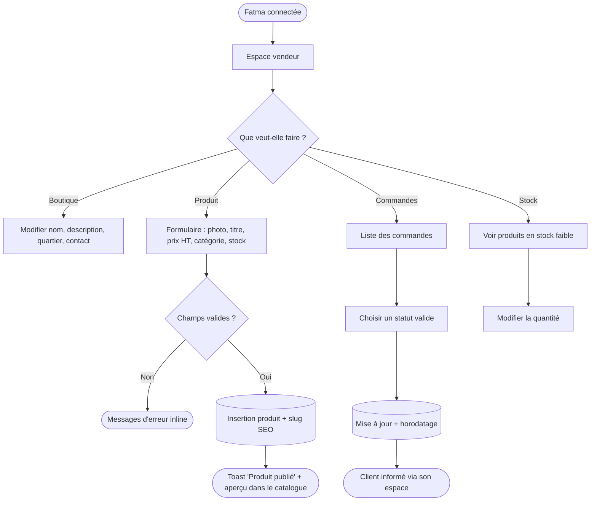
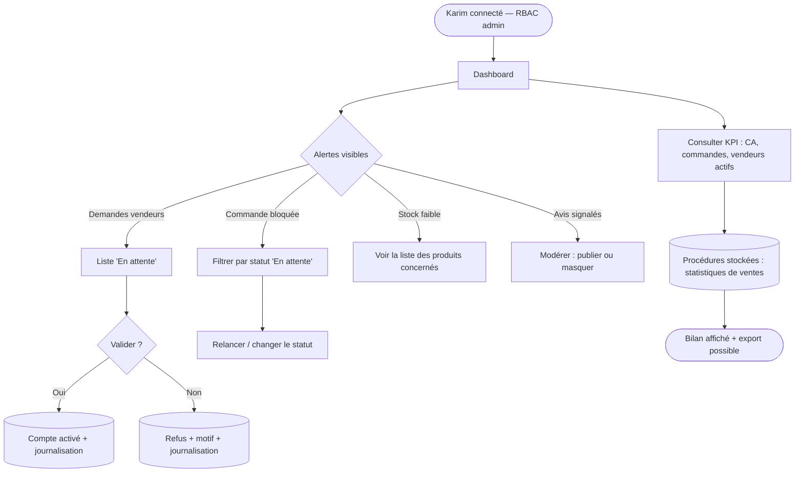
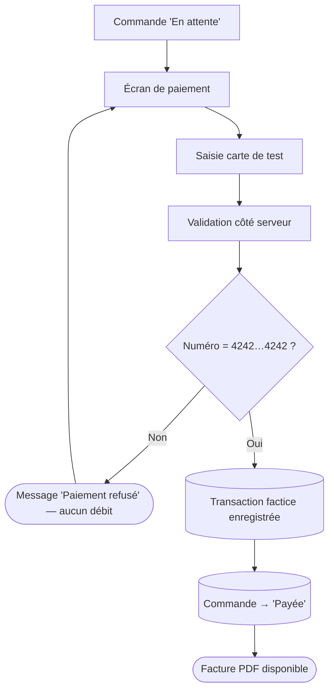
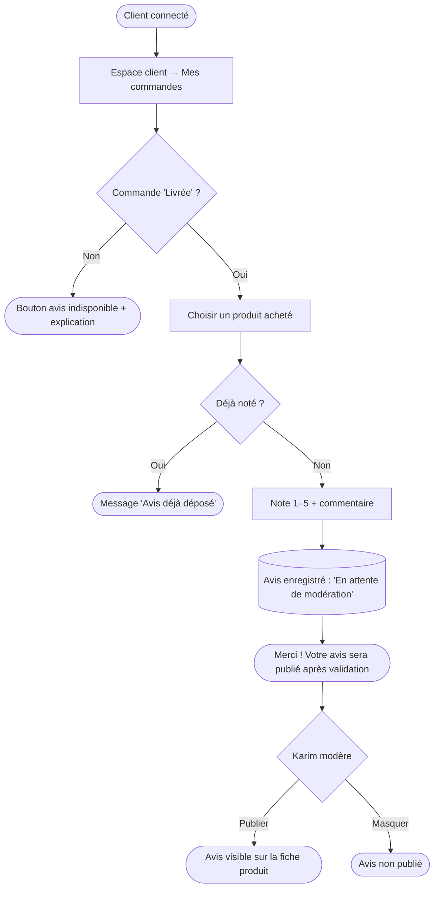

# User flows — TuniShop Marketplace

| Champ | Valeur |
|---|---|
| Version | 1.0 — 20/11/2026 |
| Outil de lecture | Diagrammes **Mermaid** ( rendus nativement sur GitHub/GitLab, ou copiables dans <https://mermaid.live> ) |
| Personas associés | Aymen (client), Fatma (vendeuse), Karim (admin) — voir [personas.md](personas.md) |
| Prototype cliquable | [prototype_tunishop.html](prototype_tunishop.html) |

Légende des couleurs Mermaid : 🟢 succès / état final · 🟡 décision · 🔵 action utilisateur · 🔴 erreur.

---

## 1. Flux principal — Parcours d'achat client (happy path)

### Étapes détaillées

| # | Étape | Écran | Action utilisateur | Feedback système | US |
|---|---|---|---|---|---|
| 1 | Découverte | Accueil | Clique sur « Découvrir le catalogue » | Navigation vers catalogue | US-019 |
| 2 | Exploration | Catalogue | Filtre par catégorie / prix / vendeur | Grille mise à jour sans rechargement (fetch) | US-020, US-022, US-033 |
| 3 | Décision | Fiche produit | Lit photos, prix TTC, stock, avis | Badge « 7 en stock », note 4,8/5 | US-021 |
| 4 | Ajout | Fiche produit | Clique « Ajouter au panier » | Toast « Ajouté au panier » + badge panier (2) | US-035 |
| 5 | Contrôle | Panier | Modifie quantité, saisit code promo (option) | Recalcul HT / TVA 19 % / livraison / total | US-036, US-054 |
| 6 | Checkout | Livraison | Renseigne adresse, choisit livraison ou retrait | Récapitulatif latéral mis à jour | US-037, US-055 |
| 7 | Paiement | Paiement | Saisit `4242 4242 4242 4242` / date / `123` | Mention « Simulation — aucun débit réel » | US-038 |
| 8 | Confirmation | Confirmation | Lit le numéro de commande | `CMD-2026-0001`, bouton facture PDF | US-037, US-044 |
| 9 | Suivi | Espace client | Consulte « Mes commandes » | Statut `Payée → En préparation → Expédiée → Livrée` | US-043 |
| 10 | Avis | Espace client | Note 5/5 + commentaire | Avis « En attente de modération » | US-045 |

### Chemins alternatifs et erreurs

| Situation | Comportement attendu |
|---|---|
| Visiteur non connecté au checkout | Redirection vers connexion/inscription, puis retour au panier (panier conservé) |
| Stock devenu insuffisant entre l'ajout et le paiement | Message « Stock insuffisant, quantité adjustée à N », mise à jour automatique |
| Carte invalide | Message générique « Paiement refusé », commande reste `En attente`, aucune transaction enregistrée |
| Session expirée | Redirection vers connexion avec message « Votre session a expiré » |
| Avis déjà déposé | Bouton désactivé + message « Vous avez déjà noté ce produit » |

---

## 2. Flux de recherche multicritères

**Règles :** les filtres sont conservés dans l'URL (`?q=vase&cat=ceramique&min=20&max=60`) pour permettre le partage et le référencement ; la pagination limite 12 produits par page.

---

## 3. Flux devenir vendeur (inscription + validation admin)

---

## 4. Flux vendeur — Ajout produit et suivi des commandes

**Transition de statut autorisée** (RG-04) :
`En attente → Payée → En préparation → Expédiée → Livrée` — toute transition inverse ou saut invalide est refusée et signalée.

---

## 5. Flux administrateur — Validation et pilotage

---

## 6. Flux de paiement sandbox (avec gestion d'erreur)

> **Important UX :** la mention « Mode simulation — aucune opération bancaire réelle n'est effectuée » est affichée en pendant la saisie et sur la facture, afin que le jury comprenne immédiatement le périmètre.

---

## 7. Flux de dépôt d'avis

---

## 8. Synthèse des états d'interface à prévoir

| Élément | États à designer | Où |
|---|---|---|
| Bouton | normal, survol, focus clavier, actif, chargement, désactivé | Partout |
| Champ de formulaire | vide, au focus, valide, erreur, message d'aide | Inscription, checkout, produits |
| Carte produit | normale, survol, rupture de stock, nouveau, coup de cœur | Catalogue, accueil |
| Badge commande | En attente (gris), Payée (bleu), En préparation (orange), Expédiée (violet), Livrée (vert), Annulée (rouge) | Espace client, vendeur, admin |
| Notification | succès (vert), erreur (rouge), info (bleu), avertissement (orange) | Toast global |
| Liste vide | illustration + message + action | Catalogue, commandes, avis |
| Chargement | squelette gris (skeleton) | Catalogue, dashboard |

---

## 9. Correspondance flows ↔ écrans du prototype

| Flow | Écrans du prototype |
|---|---|
| Achat | `accueil → catalogue → produit → panier → checkout → confirmation → compte` |
| Recherche | `catalogue` |
| Devenir vendeur | `accueil → vendeurs (vue admin)` |
| Vendeur | `boutique → produits → commandes` |
| Admin | `dashboard → vendeurs → commandes` |
| Paiement | `checkout → confirmation` |
| Avis | `compte → produit` |

---

## 10. Validation

- [x] 7 flows documentés (Mermaid + tableaux)
- [x] Happy path, chemins alternatifs et états d'erreur couverts
- [x] Liens explicites avec les user stories du backlog
- [ ] Flows à importer dans Figma (page `02_Flows`) — voir [prototype_figma.md](prototype_figma.md)
- [ ] Validation jalon 1 (29/11)
