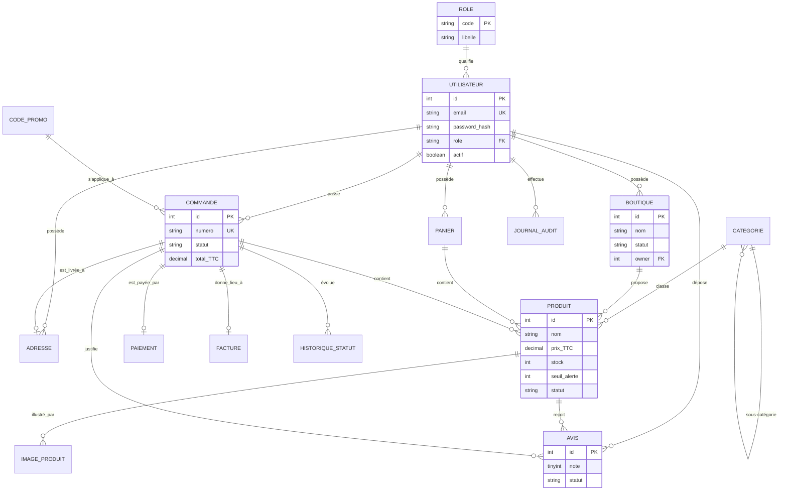
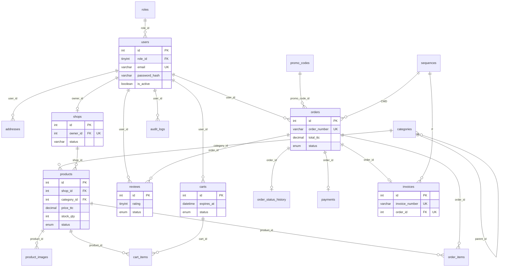

# Modèle Conceptuel (MCD) et Modèle Logique (MLD) — TuniShop

> Méthode **Merise** · MCD → MLD relationnel · MySQL 8 / InnoDB  
>Le MCD décrit *le quoi* (indépendant de la technologie), le MLD décrit *le comment* (tables, clés, contraintes).

---

## 1. MCD — Entités

Notation : **#** = identifiant, `*` = propriété obligatoire, `°` = propriété optionalle.

| Entité | Propriétés |
|---|---|
| **UTILISATEUR** | **#id_utilisateur**, *email*, *mot_de_passe_haché*, *prénom*, *nom*, °téléphone, *actif*, °email_vérifié_le, °dernière_connexion |
| **RÔLE** | **#code_rôle**, *libellé*, °description |
| **ADRESSE** | **#id_adresse**, *libellé*, *ligne1*, °ligne2, *code_postal*, *ville*, *gouvernorat*, °par_défaut |
| **CATÉGORIE** | **#id_catégorie**, *nom*, *slug*, °description, °icône, *ordre*, *active* |
| **BOUTIQUE** | **#id_boutique**, *nom*, *slug*, °description, *adresse*, °quartier, *téléphone*, *email*, °logo, *statut*, °motif_refus, *date_demande*, °date_validation |
| **PRODUIT** | **#id_produit**, *nom*, *slug*, °description_courte, °description, *prix_TTC*, *stock*, *seuil_alerte*, *statut*, °coups_de_coeur, °date_publication |
| **IMAGE_PRODUIT** | **#id_image**, *chemin*, *texte_alternatif*, °principale, *ordre* |
| **CODE_PROMO** | **#code**, *type*, *valeur*, °montant_min, °début, °fin, °nb_max, *actif* |
| **PANIER** | **#id_panier**, °jeton_invité, *statut*, *date_expiration*, *date_création* |
| **COMMANDE** | **#id_commande**, *numéro*, *date*, *statut*, *mode_livraison*, *sous_total_HT*, *montant_TVA*, *sous_total_TTC*, *remise*, *frais_livraison*, *total_TTC*, °référence_transaction, °date_paiement |
| **LIGNE_COMMANDE** | **#id_ligne**, *quantité*, *prix_unitaire_TTC*, *total_ligne*, *nom_produit_snapshot* |
| **PAIEMENT** | **#id_paiement**, *référence_sandbox*, *montant*, *statut*, °date_traitement |
| **FACTURE** | **#numéro_facture**, *date_émission*, *sous_total_HT*, *TVA*, *frais*, *total_TTC*, °chemin_PDF |
| **AVIS** | **#id_avis**, *note*, *commentaire*, *statut_modération*, °date_modération |
| **HISTORIQUE_STATUT** | **#id_historique**, °statut_source, *statut_cible*, *date_changement*, °note |
| **JOURNAL_AUDIT** | **#id_log**, *action*, *entité*, °id_entité, °IP, °details, *date* |
| **INSCRIPTION_NEWS** | **#email**, *date_inscription*, *active* |
| **MESSAGE_CONTACT** | **#id_message**, *nom*, *email*, *objet*, *contenu*, *lu*, *date* |

---

## 2. MCD — Associations et cardinalités

| Association | Cardinalités | Signification |
|---|---|---|
| **RÔLE** — `qualifie` — **UTILISATEUR** | 1,n / 0,1 | Un rôle qualifie plusieurs utilisateurs ; un utilisateur a un seul rôle |
| **UTILISATEUR** — `possède` — **ADRESSE** | 1,1 / 0,n | Une adresse appartient à un utilisateur ; un utilisateur peut en avoir plusieurs |
| **UTILISATEUR** — `possède` — **PANIER** | 0,1 / 0,n | Un panier appartient à un utilisateur connecté (ou à un invité) |
| **UTILISATEUR** — `passe` — **COMMANDE** | 0,1 / 0,n | Une commande est passée par un utilisateur (ou invité) |
| **COMMANDE** — `est_livrée_à` — **ADRESSE** | 0,1 / 0,n | Snapshot de l'adresse au moment de la commande |
| **COMMANDE** — `contient` — **PRODUIT** | 1,n / 0,n | Association **portant** la quantité et le prix → *LIGNE_COMMANDE* |
| **BOUTIQUE** — `appartient_à` — **UTILISATEUR** | 0,1 / 0,1 | Un vendeur possède une seule boutique |
| **BOUTIQUE** — `propose` — **PRODUIT** | 1,1 / 0,n | Un produit appartient à une boutique |
| **CATÉGORIE** — `classe` — **PRODUIT** | 1,1 / 0,n | Une catégorie contient plusieurs produits |
| **CATÉGORIE** — `a_sous_catégorie` — **CATÉGORIE** | 0,1 / 0,n | Auto-association (arborescence) |
| **PRODUIT** — `illustré_par` — **IMAGE_PRODUIT** | 1,1 / 0,n | Une image illustre un produit |
| **PANIER** — `contient` — **PRODUIT** | 1,1 / 0,n | Association portant quantité → *LIGNE_PANIER* |
| **COMMANDE** — `est_payée_par` — **PAIEMENT** | 0,1 / 1,1 | Un paiement sandbox correspond à une commande |
| **COMMANDE** — `donne_lieu_à` — **FACTURE** | 0,1 / 0,1 | Facture générée après paiement (RG-08) |
| **UTILISATEUR** — `dépose` — **AVIS** | 0,1 / 0,n | Un avis est déposé par un client |
| **PRODUIT** — `reçoit` — **AVIS** | 1,1 / 0,n | Un produit peut recevoir plusieurs avis modérés |
| **COMMANDE** — `justifie` — **AVIS** | 1,1 / 0,1 | 1 avis max par produit **et** par commande (RG-05) |
| **COMMANDE** — `évolue` — **HISTORIQUE_STATUT** | 1,1 / 0,n | Traçabilité du cycle RG-04 |
| **UTILISATEUR** — `effectue` — **JOURNAL_AUDIT** | 0,1 / 0,n | Action sensible tracée (RG-11) |
| **CODE_PROMO** — `s'applique_à` — **COMMANDE** | 0,1 / 0,n | Remise optionnelle (US-054) |

---

## 3. MCD — Diagramme global (Mermaid)



---

## 4. Passage MCD → MLD (règles appliquées)

| Règle Merise | Application dans TuniShop |
|---|---|
| Entité → relation | Chaque entité devient une table (20 tables) |
| Identifiant → clé primaire | `id` auto-incrémenté sauf `roles.code`, `promo_codes.code` (PK naturelle) |
| Association 1,n → FK du côté « n » | `products.shop_id`, `orders.user_id`, `reviews.product_id`… |
| Association 1,1 → FK + `UNIQUE` | `shops.owner_id UNIQUE`, `payments.order_id UNIQUE`, `invoices.order_id UNIQUE` |
| Association n,n → table de jonction | `cart_items`, `order_items` (associations **portant** quantité + prix) |
| Propriété sur association | `order_items.quantity`, `order_items.unit_price_ttc`, `cart_items.quantity` |
| Auto-association | `categories.parent_id` (FK réflexive, `ON DELETE SET NULL`) |
| Généralisation/rôle | `users.role_id` → `roles.id` (RBAC) |
| Contrainte métier | `CHECK`, `ENUM`, triggers et procédures (voir §6) |

---

## 5. MLD — Relations (clés)

```
RÔLE(#code, libellé, description)
SEQUENCES(#seq_name, #seq_year, next_value)
UTILISATEUR(#id, role_id*, email*, password_hash*, prénom*, nom*, téléphone,
            actif*, email_vérifié_le, dernière_connexion, reset_token, reset_expiration)
ADRESSE(#id, user_id*, libellé*, ligne1*, ligne2, code_postal*, ville*,
        gouvernorat*, par_défaut)
CATEGORIE(#id, parent_id, nom*, slug*, description, icône, ordre*, active*)
BOUTIQUE(#id, owner_id* [UK], nom*, slug*, description, adresse*, quartier,
         téléphone*, email*, logo, statut*, motif_refus, date_demande*,
         date_validation, validated_by)
PRODUIT(#id, shop_id*, category_id*, nom*, slug*, description_courte,
        description, prix_TTC*, stock*, seuil_alerte*, statut*,
        coups_de_coeur, vues*, date_publication)
IMAGE_PRODUIT(#id, product_id*, chemin*, texte_alternatif*, principale, ordre*)
CODE_PROMO(#code, type*, valeur*, montant_min, début, fin, nb_max, nb_utilisé*, actif*)
PANIER(#id, user_id, jeton_invité [UK], statut*, date_expiration*, created_at*)
LIGNE_PANIER(#id, cart_id*, product_id*, quantité*, prix_unitaire_TTC*, [UK cart_id+product_id])
COMMANDE(#id, numéro* [UK], user_id, email_invité, statut*, mode_livraison*,
         sous_total_HT*, TVA*, sous_total_TTC*, remise*, frais_livraison*,
         total_TTC*, promo_code_id, address_id, adresse_snapshot…,
         référence_transaction [UK], méthode_paiement, payée_le, passée_le*)
LIGNE_COMMANDE(#id, order_id*, product_id*, shop_id*, nom_produit*, slug*,
               prix_unitaire_TTC*, quantité*, total_ligne*)
PAIEMENT(#id, order_id* [UK], référence* [UK], méthode*, montant*, statut*, traité_le)
FACTURE(#numéro* [UK], order_id* [UK], émise_le*, HT*, TVA*, frais*, remise*, total*, pdf)
AVIS(#id, user_id*, product_id*, order_id*, note* [1..5], commentaire*,
     statut*, moderated_by, moderated_at, [UK user_id+product_id+order_id])
HISTORIQUE_STATUT(#id, order_id*, statut_source, statut_cible*, changed_by, note, created_at*)
JOURNAL_AUDIT(#id, user_id, action*, entité*, id_entité, IP, user_agent, details, created_at*)
INSCRIPTION_NEWS(#email, active*, date_inscription*)
MESSAGE_CONTACT(#id, nom*, email*, objet*, contenu*, lu*, date*)
```

---

## 6. Traduction des règles métier en contraintes

| RG | Mécanisme MLD |
|---|---|
| RG-01 | `trg_order_items_ai` (décrement + `SIGNAL` si stock < quantité) · `trg_cart_items_bi` · `SELECT … FOR UPDATE` dans `sp_place_order` |
| RG-02 | `price_ttc` stocké TTC · `fn_vat_from_ttc()` · `invoices` détaillée |
| RG-03 | `sp_calculate_cart_totals()` : 8 DT si `subtotal_ttc < 100`, 0 DT sinon ou si `delivery_mode='retrait'` |
| RG-04 | `orders.status ENUM` + `sp_update_order_status()` + `order_status_history` |
| RG-05 | `UNIQUE(user_id, product_id, order_id)` + `trg_reviews_bi` + `fn_can_review()` |
| RG-06 | `trg_shops_bi` (statut forcé) + `trg_products_bi/bu` (refus publication si boutique non validée) |
| RG-07 | Table `payments` sans champ bancaire · `transaction_ref` factice `SBX-…` |
| RG-08 | `sequences` + `fn_next_sequence()` + `trg_orders_au` (création facture au paiement) |
| RG-09 | `password_hash VARCHAR(255)` (Argon2id/bcrypt) |
| RG-10 | `carts.expires_at` + `sp_purge_abandoned_carts()` |
| RG-11 | `audit_logs` + triggers `trg_users_bu`, `trg_shops_au`, `trg_orders_au`, `trg_reviews_bu` |

---

## 7. Normalisation et choix de conception

- **1NF** : pas de groupes répétitifs (galerie photos → `product_images`, lignes → `cart_items`/`order_items`).
- **2NF** : toutes les propriétés dépendent de la clé primaire complète (pas de clé composée métier, sauf `sequences`).
- **3NF** : pas de dépendance transitive (catégorie et boutique référencées par `id`, leurs libellés ne sont pas dupliqués dans `products`).
- **Snapshots volontaires** : `order_items.product_name`, `unit_price_ttc` et `orders.shipping_*` dupliquent volontairement des données pour garantir l'intégrité historique d'une facture même si le produit ou l'adresse change ensuite (exception documentée à la 3NF).
- **Dénormalisation de lecture** : `v_catalogue` et `v_seller_sales` calculent les agrégats (notes, CA) pour les écrans, sans stocker de données redondantes.
- **Verrouillage** : le checkout verrouille le panier et les produits (`FOR UPDATE`) avant de créer les lignes ; le trigger garantit l'invariant même en cas d'appel direct.

---

## 8. Diagramme MLD détaillé (Mermaid)


