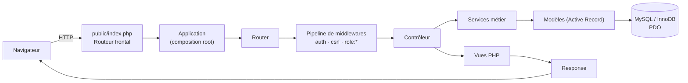

# TuniShop — Architecture MVC (socle applicatif)

> Ce document décrit l'architecture logicielle livrée dans `app/`, `config/` et `public/`.
> Les diagrammes UML correspondants sont dans [diagrammes_uml.md](diagrammes_uml.md).

---

## 1. Vue d'ensemble

TuniShop suit une architecture **MVC (Model–View–Controller)** à routeur frontal, complétée par une couche **Services** et un pipeline de **middlewares**.



### Responsabilités des couches

| Couche | Responsabilité | Ne doit PAS faire |
|---|---|---|
| **Routeur frontal** | Amorcer l'application, capter les erreurs, envoyer la réponse | Contenir de la logique métier |
| **Application** | Instancier et injecter les dépendances (composition root) | Interroger la base directement |
| **Router** | Associer méthode + URL → contrôleur, appliquer les middlewares | Valider les données de formulaire |
| **Middleware** | Contrôles transverses : session, CSRF, rôles | Rendre du HTML |
| **Contrôleur** | Orchestrer requête → service → vue, gérer les redirections | Écrire des SQL métier |
| **Service** | Règles métier, appels aux procédures stockées | Générer du HTML |
| **Modèle** | Accès aux données, CRUD, requêtes de lecture | Décider des règles métier |
| **Vue** | Présentation, échappement HTML | Accéder à PDO |
| **Base de données** | Intégrité, transactions, TVA, stock, audit, facturation | Connaître l'URL ou le HTML |

---

## 2. Flux d'une requête (ex. `GET /produit/vase-bleu-et-blanc`)

1. `public/index.php` charge `vendor/autoload.php`, lit `config/*.php`, crée `Application`.
2. `Request::fromGlobals()` construit la requête (méthode, chemin normalisé, paramètres, en-têtes).
3. `Application::handle()` :
   - pose `@current_user_id`, `@client_ip`, `@client_ua` via `Database::setAuditContext()` (**RG-11**) ;
   - configure `AuditService` avec le même contexte ;
   - délègue au `Router`.
4. `Router::dispatch()` parcourt les 22 routes ; `GET /produit/{slug}` correspond.
   - `setRouteParams(['slug' => 'vase-bleu-et-blanc'])` ;
   - aucun middleware pour cette route ;
   - `callHandler()` instancie `CatalogController` avec ses dépendances.
5. `CatalogController::show(request, slug)` :
   - `Product::findBySlug()` → `SELECT … FROM v_catalogue WHERE slug = ?` ;
   - `NotFoundException` si absent ;
   - `View::render('catalog/show', …)` insère la vue dans `layouts/main.php`.
6. `Response::html(...)` est renvoyée, puis `send()` écrit le statut, les en-têtes et le corps.

> Les paramètres de route deviennent des **arguments nommés** (`$controller->{$action}(...$args)`), une fonctionnalité PHP 8. Les segments entièrement numériques sont convertis en `int` pour les actions typées (`int $id`).

---

## 3. Composants du noyau (`app/Core/`)

### `Application` — composition root
Construit une seule fois `Database`, `Session`, `View` et `Router`, puis enregistre les middlewares. C'est le seul endroit où les dépendances concrètes sont choisies (principe d'inversion de dépendance).

```php
$app = new Application(
    ['app' => $appConfig, 'database' => $dbConfig, 'views' => $root . '/app/Views'],
    $routes
);
$response = $app->handle(Request::fromGlobals());
$response->send();
```

### `Router` — correspondance et pipeline
- `match()` compile un motif `/produit/{slug}` en expression régulière nommée ;
- `addMiddleware()` enregistre les middlewares par nom (`auth`, `csrf`) ;
- `setMiddlewareFactory()` résout les middlewares paramétrés (`role:vendeur`, `role:admin`) ;
- les middlewares sont enveloppés en ordre inverse pour former la chaîne :  
  `auth → role → csrf → contrôleur`.

### `Request` — requête entrante
Propriétés `readonly` : `method`, `path`, `query`, `post`, `server`, `rawBody`.
Méthodes utiles : `input()`, `query()`, `header()`, `ip()`, `userAgent()`, `isJson()`, `routeParam()`, `routeParams()`.
`normalizePath()` évite les `//` et les slashs finaux.

### `Response` — réponse sortante
`readonly` : `body`, `status`, `headers`.
Fabriques : `html()`, `json()`, `redirect()`, `empty()`. `send()` applique le code HTTP, les en-têtes puis le corps.

### `Session`
- cookies `HttpOnly`, `SameSite=Lax`, `Secure` configurable ;
- `regenerate()` après connexion (prévention de la fixation de session) ;
- `flash()` pour les messages à consommation unique ;
- `csrfToken()` / `validateCsrf()` avec comparaison `hash_equals()` ;
- en CLI (`tests/run.php`), un stockage en mémoire remplace `$_SESSION` sans démarrer de session réelle.

### `View`
`render($template, $data, $layout)` inclut un gabarit PHP dans `layouts/main.php`.
`View::e()` centralise `htmlspecialchars(..., ENT_QUOTES | ENT_SUBSTITUTE, 'UTF-8')` contre les XSS.

### `Database`
- connexion PDO paresseuse, `SET NAMES utf8mb4 COLLATE utf8mb4_unicode_ci` ;
- `ATTR_EMULATE_PREPARES = false` (vraies requêtes préparées) ;
- `fetch/fetchAll/scalar/execute` ;
- `call()` gère les paramètres `OUT` des procédures via variables SQL (`@p_order_id`…) ;
- `identifier()` applique une whitelist regex sur tout nom de table/colonne interpolé ;
- `beginTransaction()/commit()/rollBack()` ;
- `setAuditContext()` applique les variables de session attendues par les triggers **RG-11** (différées si la PDO n'est pas encore ouverte).

### `Controller` (abstraite)
Fournit `render()`, `json()`, `redirect()` et conserve les trois dépendances partagées (`Database`, `Session`, `View`) en propriétés `protected readonly`.

---

## 4. Table de routage (`config/routes.php`)

22 routes au format `[MÉTHODE, CHEMIN, Contrôleur@action, MIDDLEWARES, NOM]`.

| Groupe | Routes | Middlewares |
|---|---|---|
| Public | `/`, `/catalogue`, `/produit/{slug}`, `/api/produits` | — |
| Panier | `/panier`, `/panier/ajouter`, `/panier/supprimer` | `csrf` sur POST |
| Auth | `/connexion`, `/inscription`, `/deconnexion` | `csrf` sur POST, `auth` sur logout |
| Commande | `/commande`, `/commande/{id}` | `auth`, `csrf` sur POST |
| Vendeur | `/vendeur`, `/vendeur/produits`, `/vendeur/commandes` | `auth`, `role:vendeur` |
| Admin | `/admin`, `/admin/vendeurs`, `/admin/vendeurs/{id}/valider` | `auth`, `role:admin`, `csrf` |
| Supervision | `/sante` | — |

### Middlewares

| Middleware | Rôle | Comportement |
|---|---|---|
| `AuthMiddleware` | Exiger une session | 302 vers `/connexion` (HTML) ou 401 (JSON/API) |
| `RoleMiddleware` | RBAC | 403 `ForbiddenException` si le rôle n'est pas autorisé |
| `CsrfMiddleware` | Jetons sur méthodes modifiantes | 419 si `_token` ou `X-CSRF-Token` absent/invalide |

`MiddlewareInterface::handle(Request, callable): Response` suit le pattern **Chaîne de responsabilité** : chaque middleware peut court-circuiter `$next`.

---

## 5. Modèles et services

### Modèles (`app/Models/`)

| Classe | Table / vue | Responsabilité |
|---|---|---|
| `Model` (abstract) | — | CRUD générique sécurisé (`find`, `all`, `where`, `create`, `update`, `delete`, `count`) |
| `Product` | `products`, `v_catalogue`, `v_low_stock`, `product_images` | Catalogue filtré, fiche produit, alertes stock |
| `Category` | `categories` | Catégories actives |
| `Shop` | `shops`, `users` | Boutiques en attente / validées |
| `Cart` | `carts`, `cart_items`, `v_cart_totals` | Panier actif, lignes, totaux |
| `Order` | `orders`, `order_items`, `invoices`, `order_status_history` | Commandes client, facture, historique |
| `User` | `users`, `roles` | Authentification Argon2id, inscription client |

Tout identifiant SQL passe par `Database::identifier()` : aucune concaténation libre de valeur utilisateur dans une requête.

### Services (`app/Services/`)

| Classe | Règles | Méthodes clés |
|---|---|---|
| `CartService` | RG-01, RG-02, RG-03, RG-10 | `currentCartId()`, `add()`, `remove()`, `items()`, `totals()` |
| `OrderService` | RG-04, RG-08, RG-11 | `place()` → `sp_place_order()` + audit |
| `PaymentService` | RG-07 | `isValidTestCard()`, `simulate()` → `sp_simulate_payment()` |
| `ShopService` | RG-06 | `validate()` → `sp_validate_shop()` |
| `AuditService` | RG-11 | `configure()`, `log()` → `sp_log_action()` |

> La logique critique (stock, TVA, séquences de factures, transitions de statut) reste dans la base : PHP orchestre, la BDD garantit l'intégrité transactionnelle.

---

## 6. Contrôleurs et vues

| Contrôleur | Actions | Vues associées |
|---|---|---|
| `HomeController` | `index` | `home/index` |
| `CatalogController` | `index`, `show` | `catalog/index`, `catalog/show` |
| `CartController` | `index`, `add`, `remove` | `cart/index` |
| `AuthController` | `loginForm`, `login`, `registerForm`, `register`, `logout` | `auth/login`, `auth/register` |
| `OrderController` | `checkout`, `place`, `confirmation` | `checkout/index`, `order/confirmation` |
| `SellerController` | `dashboard`, `products`, `orders` | `dashboard/index` |
| `AdminController` | `dashboard`, `shops`, `validateShop` | `dashboard/index` |
| `ApiController` | `products` | JSON |
| `SystemController` | `health` | JSON |

Le layout unique `app/Views/layouts/main.php` contient l'en-tête, la navigation conditionnelle selon le rôle, les messages flash et le pied de page.

---

## 7. Gestion des erreurs et sécurité

- `HttpException` (abstraite) transporte un code HTTP et produit une page d'erreur **neutre** ;
- `NotFoundException` (404), `ForbiddenException` (403), `ValidationException` (422) ;
- `public/index.php` intercepte `Throwable` : en production, aucun détail technique n'est affiché (`APP_DEBUG=false`) ;
- échappement HTML systématique via `View::e()` ;
- jeton CSRF sur tous les POST ;
- RBAC vérifié **côté serveur** (middlewares) et non seulement dans la navigation ;
- aucun secret dans le dépôt : `.env.example` seul versionné, `.env` ignoré ;
- mot de passe haché en Argon2id, jamais journalisé.

---

## 8. Arborescence finale

```text
TuniShop/
├── composer.json
├── .env.example
├── config/
│   ├── app.php
│   ├── database.php
│   └── routes.php
├── public/
│   ├── index.php
│   ├── assets/css/app.css
│   └── uploads/.gitkeep
├── app/
│   ├── Core/{Application,Router,Request,Response,Session,View,Database,Controller}.php
│   ├── Middlewares/{MiddlewareInterface,AuthMiddleware,RoleMiddleware,CsrfMiddleware}.php
│   ├── Exceptions/{HttpException,NotFoundException,ForbiddenException,ValidationException}.php
│   ├── Models/{Model,Product,Category,Shop,Cart,Order,User}.php
│   ├── Services/{CartService,OrderService,PaymentService,ShopService,AuditService}.php
│   ├── Controllers/{Home,Catalog,Cart,Auth,Order,Seller,Admin,Api,System}Controller.php
│   └── Views/{layouts,home,catalog,cart,auth,checkout,order,dashboard}/*.php
└── tests/run.php
```
