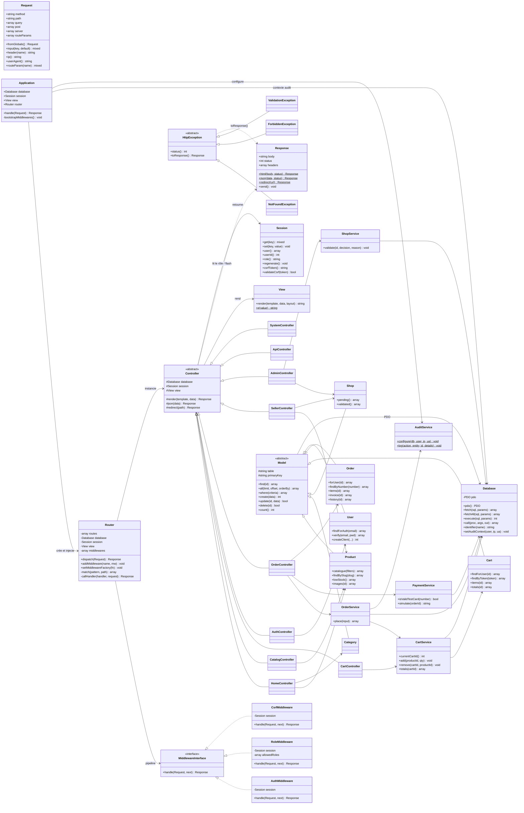
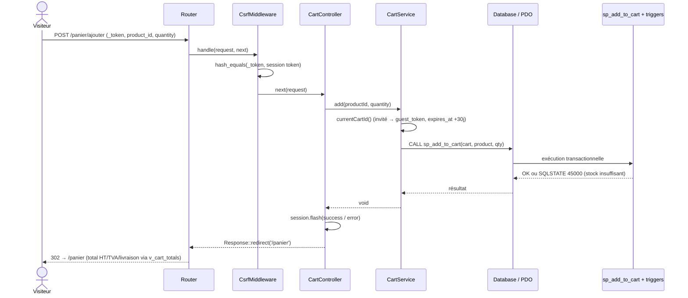
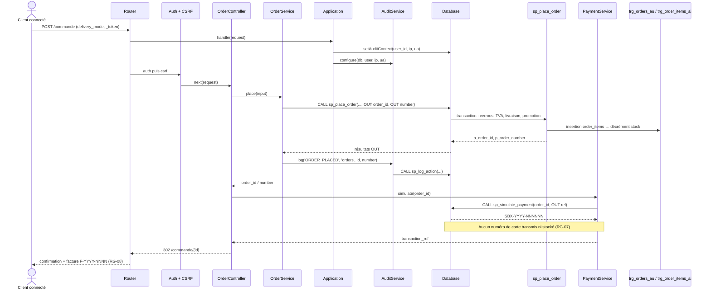
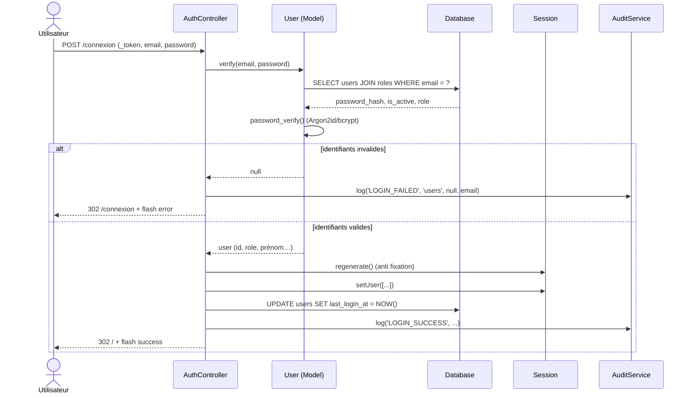
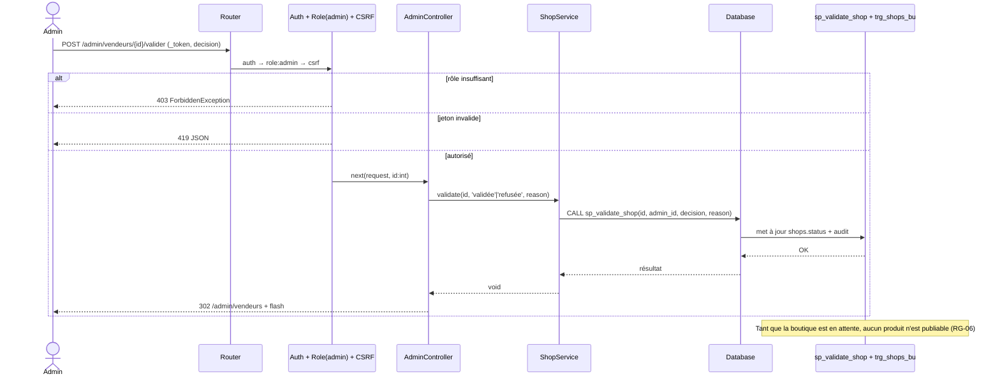
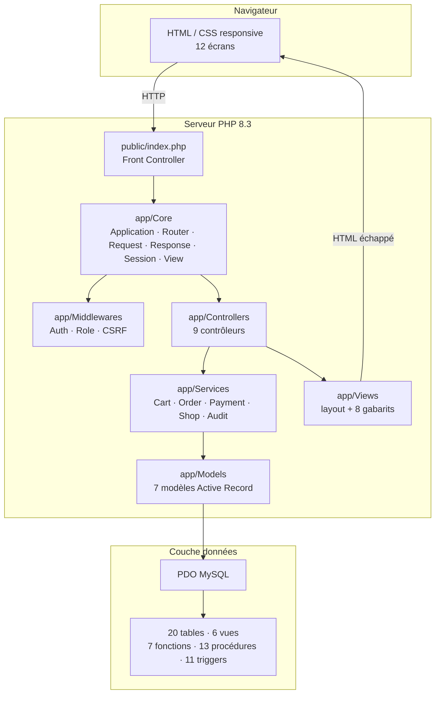
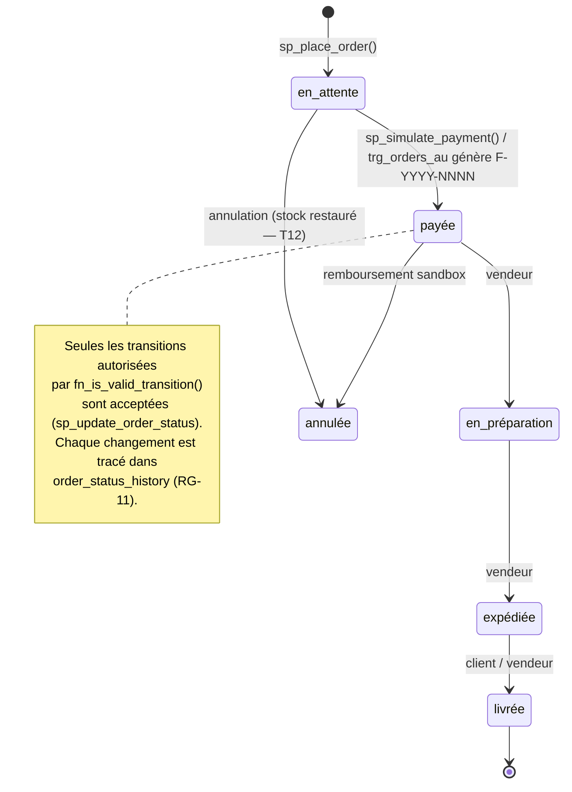
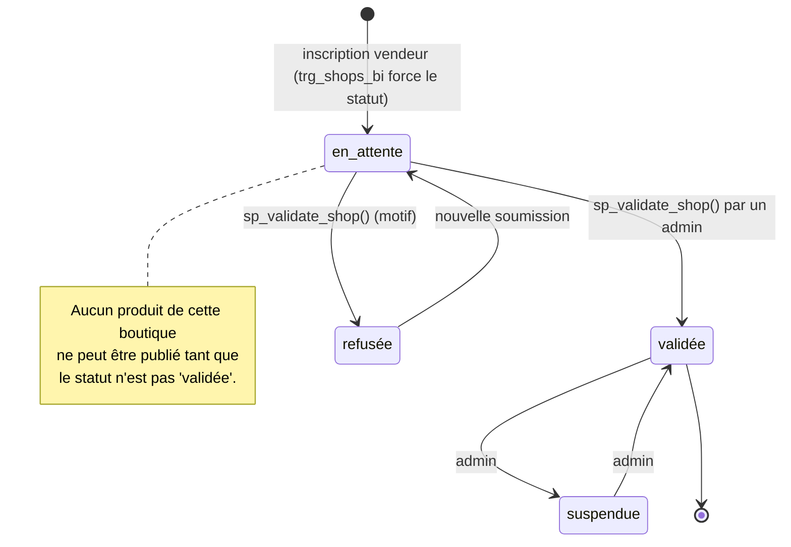

# TuniShop — Diagrammes UML

> Diagrammes en notation **Mermaid** (compatibles GitHub, VS Code, MkDocs et la plupart des éditeurs Markdown).
> Ils modélisent le socle MVC livré dans `app/` et s'appuient sur le [modèle de données](../04_bdd/mcd_mld.md).

---

## 1. Diagramme de cas d'utilisation

```mermaid
flowchart LR
    subgraph Acteurs
        V[Visiteur]
        C[Client]
        S[Vendeur]
        A[Administrateur]
    end

    subgraph System["TuniShop"]
        UC1(Consulter le catalogue)
        UC2(Rechercher / filtrer)
        UC3(Voir une fiche produit)
        UC4(Gérer son panier)
        UC5(Créer un compte / se connecter)
        UC6(Passer commande)
        UC7(Payer en sandbox)
        UC8(Consulter ses commandes / facture)
        UC9(Deposer un avis)
        UC10(Gérer sa boutique et ses stocks)
        UC11(Valider une boutique)
        UC12(Modérer un avis)
        UC13(Consulter le tableau de bord)
    end

    V --> UC1
    V --> UC2
    V --> UC3
    V --> UC4
    V --> UC5
    C --> UC6
    C --> UC7
    C --> UC8
    C --> UC9
    S --> UC10
    S --> UC13
    A --> UC11
    A --> UC12
    A --> UC13

    UC6 ..> UC4 : <<include>>
    UC6 ..> UC7 : <<include>>
    UC9 ..> UC8 : <<include>> (achat vérifié — RG-05)
    UC11 ..> UC10 : <<extend>> (débloque la publication — RG-06)
```

---

## 2. Diagramme de classes (socle MVC)



---

## 3. Diagrammes de séquence

### 3.1 Ajout au panier (RG-01, RG-02/03, RG-10)



### 3.2 Commande et paiement simulé (RG-04, RG-07, RG-08, RG-11)



### 3.3 Connexion (RG-09, RG-11)



### 3.4 Validation d'une boutique (RG-06)



---

## 4. Diagramme de composants (déploiement logique)



---

## 5. Diagramme d'états — cycle de vie d'une commande (RG-04)



### Diagramme d'états — cycle de vie d'une boutique (RG-06)



---

## 6. Correspondance avec les user stories

| Diagramme | User stories |
|---|---|
| Cas d'utilisation | US-019 à US-025, US-031 à US-044 |
| Classes | US-025, US-026, US-027 |
| Séquence ajout panier | US-035, US-036 |
| Séquence commande / paiement | US-037, US-038, US-047 |
| Séquence connexion | US-040, US-053 |
| Séquence validation vendeur | US-041, US-042 |
| Composants | US-025, NFR-01 |
| États commande | US-039, RG-04 |
| États boutique | US-041, RG-06 |
