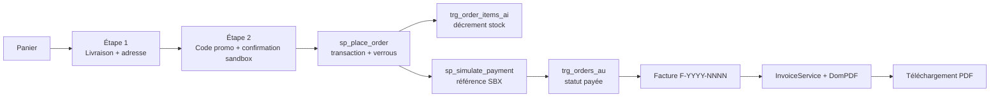

# TuniShop — Livrables E-commerce (module transactionnel)

| Champ | Valeur |
|---|---|
| **Matière** | E-commerce — panier, tunnel de commande, paiement, facturation |
| **Période** | Sprint 7 → Sprint 8 (Validation 2 : 20/12/2026, Préjury : 10/01/2027) |
| **User stories** | US-035 à US-038, US-043 à US-045, US-054 ; FR-08 à FR-15, FR-26 |
| **Règles métier** | RG-01 à RG-04, RG-07, RG-08, RG-10 |
| **Références** | [Socle MVC](../05_backend/README.md) · [Base de données](../04_bdd/README.md) · [Prototype UX](../02_ux_ui/prototype_tunishop.html) |

---

## 1. Fichiers livrés

| Document | Contenu |
|---|---|
| [parcours_client.md](parcours_client.md) | Panier persistant, modification des quantités, tunnel de commande en 3 étapes, codes promo |
| [paiement_sandbox.md](paiement_sandbox.md) | Paiement simulé, carte de test, RG-07, sécurité des données bancaires |
| [facturation_pdf.md](facturation_pdf.md) | Facture `F-YYYY-NNNN`, DomPDF, modèle HTML, stockage et téléchargement (FR-26, RG-08) |
| [tests_ecommerce.md](tests_ecommerce.md) | 15 scénarios de recette, commandes et résultats |

### Code du module

| Fichier | Rôle |
|---|---|
| `app/Models/Address.php` | Adresses de livraison du client, vérification de propriété |
| `app/Services/CartService.php` | `updateQuantity()` (FR-08), appels à `sp_add_to_cart` |
| `app/Services/OrderService.php` | `place()` → `sp_place_order()` + audit (RG-11) |
| `app/Services/PaymentService.php` | Validation cosmétique de la carte + `sp_simulate_payment()` |
| `app/Services/InvoiceService.php` | Rendu HTML/PDF, enregistrement dans `public/factures/`, mise à jour `pdf_path` |
| `app/Controllers/OrderController.php` | 3 étapes du checkout, confirmation, téléchargement PDF |
| `app/Views/checkout/index.php` | Formulaires livraison et paiement (sans champs bancaires nommés) |
| `app/Views/cart/index.php` | Modification de quantité + suppression |
| `app/Views/order/confirmation.php` | Lien de téléchargement de la facture |
| `app/Views/invoices/pdf.php` | Gabarit HTML de la facture A4 |
| `config/routes.php` | Route supplémentaire `GET /commande/{id}/facture.pdf` (23 routes à l'issue du module, 26 après intégration frontend) |
| `tests/ecommerce.php` | Recette CLI du module (15 tests) |

---

## 2. Chaîne transactionnelle de bout en bout



| Étape | Contrôleur / Service | Garde-fou |
|---|---|---|
| Panier | `CartService::updateQuantity()` | `sp_add_to_cart` + `trg_cart_items_bu` (RG-01) |
| Livraison | `OrderController::saveDelivery()` | `Address::belongsToUser()` — une adresse ne peut pas être empruntée |
| Commande | `OrderService::place()` | `sp_place_order` : panier actif, stock, promo, TVA, livraison |
| Paiement | `PaymentService::simulate()` | `sp_simulate_payment` : une seule fois par commande |
| Facture | `trg_orders_au` | `F-YYYY-NNNN` via `fn_next_sequence()` (RG-08) |
| PDF | `InvoiceService` | RBAC : client propriétaire ou administrateur |

---

## 3. Règles métier vérifiées

| Règle | Implémentation e-commerce |
|---|---|
| **RG-01** | Refus si quantité > stock, côté procédure **et** trigger ; message flash « Stock insuffisant » |
| **RG-02** | Prix TTC affichés partout ; facture détaille HT, TVA 19 % incluse, TTC |
| **RG-03** | 8 DT, offerts ≥ 100 DT, retrait à l’atelier = 0 DT (`v_cart_totals`, `sp_place_order`) |
| **RG-04** | Statut `en_attente` à la commande, `payée` après simulation ; historique tracé |
| **RG-07** | Champs de carte **sans attribut `name`** : aucune donnée bancaire n’atteint le serveur ; seule la référence `SBX-…` est stockée |
| **RG-08** | Facture créée par trigger au premier passage en `payée`, numéro `F-YYYY-NNNN`, PDF téléchargeable |
| **RG-10** | `expires_at = NOW() + 30 DAY` sur chaque panier ; `sp_purge_abandoned_carts()` |
| **RG-11** | `ORDER_CREATED`, `PAYMENT_SIMULATED`, `ORDER_STATUS_CHANGE` journalisés |

---

## 4. Validation

```powershell
# Recette du socle + du module e-commerce
& 'C:\Users\USER\AppData\Local\Composer\composer.bat' test:all

# Ou séparément
& 'C:\xampp\php\php.exe' tests/run.php        # 23 PASS / 0 FAIL
& 'C:\xampp\php\php.exe' tests/ecommerce.php  # 15 PASS / 0 FAIL
& 'C:\xampp\mysql\bin\mysql.exe' -u root -e "SOURCE C:/Users/USER/OneDrive/Desktop/TuniShop/database/tests.sql"  # 25 PASS / 0 FAIL
```

**Résultat final à ce stade : 23 + 15 + 18 (sécurité) + 25 = 81 tests au vert** ✅

> Les tests e-commerce créent des paniers et commandes temporaires puis les suppriment : le jeu d’essai de démonstration reste inchangé (vérifié par les 25 tests SQL après exécution).

---

## 5. Démarrage local

```powershell
# 1. Dépendances (y compris DomPDF 3.1.6)
& 'C:\Users\USER\AppData\Local\Composer\composer.bat' install

# 2. Serveur de développement
& 'C:\xampp\php\php.exe' -S localhost:8000 -t public
```

Parcours de démonstration :

1. Se connecter avec `aymen.benali@tunishop.tn` / `Test1234!`.
2. Ajouter le « Vase bleu et blanc » au panier, modifier la quantité.
3. `/commande` → choisir « Livraison à domicile » + l’adresse « Domicile » → Continuer.
4. Saisir `ARTISAN5` comme code promo, cocher la confirmation sandbox → Payer.
5. Sur la confirmation, cliquer sur **Télécharger la facture PDF**.

---

## 6. État d'avancement

- ✅ Panier persistant avec ajout, modification de quantité et suppression.
- ✅ Checkout 3 étapes avec adresse, retrait, code promo et confirmation sandbox.
- ✅ Paiement simulé sans aucune donnée bancaire transmise ou stockée.
- ✅ Facture PDF générée et téléchargeable (client propriétaire ou admin).
- ⏳ Modération des avis et suivi des statuts côté vendeur (Sprint 8, matière E-commerce/Back-office).
