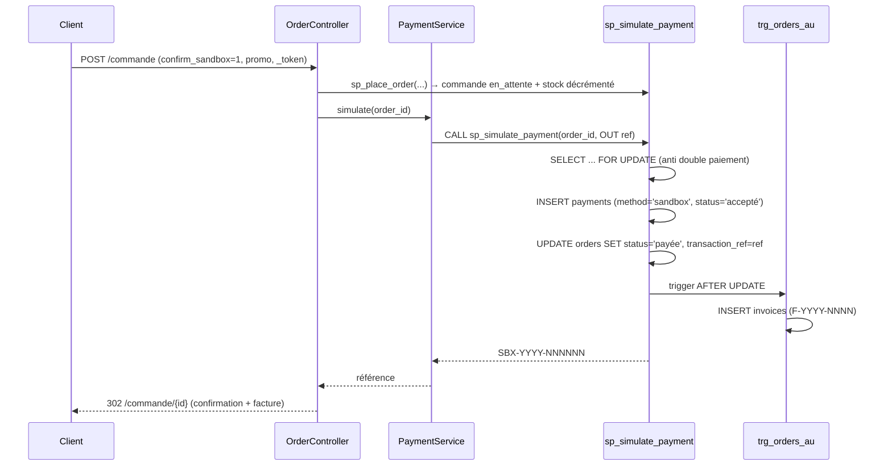

# TuniShop — Paiement simulé (sandbox)

> FR-12 et RG-07 : le paiement est **entièrement simulé**. Aucun numéro de carte, date d'expiration ou CVC n'est transmis au serveur ni conservé dans la base de données.

---

## 1. Carte de démonstration

| Champ | Valeur |
|---|---|
| Numéro | `4242 4242 4242 4242` |
| Date d'expiration | N'importe quelle date future (ex. `12/30`) |
| CVC | `123` |

Ces valeurs sont celles utilisées usuellement par les environnements de test Stripe. Elles servent uniquement à l'illustration visuelle dans la soutenance.

---

## 2. Ce qui est réellement envoyé au serveur

Le formulaire de l'étape 2 (`app/Views/checkout/index.php`) contient des champs **sans attribut `name`** :

```html
<label>Numéro de carte
  <input type="text" inputmode="numeric"
         placeholder="4242 4242 4242 4242" autocomplete="off">
</label>
```

⇒ Le navigateur n'inclut donc **aucune donnée bancaire** dans le corps de la requête POST. Seuls sont transmis :

| Champ | Rôle |
|---|---|
| `_token` | Jeton CSRF |
| `etape=2` | Identification de l'étape du tunnel |
| `confirm_sandbox` | Case cochée « Je confirme utiliser la carte de test » |
| `promo_code` | Code promo facultatif |

`PaymentService::isValidTestCard()` existe pour la démonstration et les tests (reconnaît la carte de test) ; **il n'est jamais appelé avec une valeur provenant d'un formulaire en production**.

---

## 3. Traitement côté serveur



### Garde-fous SQL

| Garde-fou | Effet |
|---|---|
| `SELECT status, total_ttc FROM orders WHERE id = ? FOR UPDATE` | Deux paiements simultanés ne peuvent pas passer |
| `IF v_status <> 'en_attente' THEN SIGNAL SQLSTATE '45000'` | Un second appel échoue avec « Paiement deja effectue » |
| `UNIQUE KEY uq_payments_order (order_id)` | Une seule ligne de paiement par commande |
| `UNIQUE KEY uq_orders_transaction (transaction_ref)` | Référence unique |
| `fn_next_sequence('PAYMENT', année)` | Référence `SBX-YYYY-NNNNNN` monotone |

---

## 4. Ce qui est stocké (et ce qui ne l'est pas)

### Table `payments`

| Colonne | Valeur | Nature |
|---|---|---|
| `id` | auto-increment | technique |
| `order_id` | FK | technique |
| `transaction_ref` | `SBX-2026-000123` | **factice** |
| `method` | `sandbox` | factice |
| `amount` | montant TTC | réel (commande) |
| `status` | `accepté` | simulation |
| `processed_at` | horodatage | réel |

### Données absentes — vérifiées par les tests

```sql
SELECT column_name FROM information_schema.columns
WHERE table_schema = 'tunishop' AND table_name = 'payments';
```

Aucune colonne `card_number`, `expiry`, `cvc`, `cvv`, `iban` ou `bank_*` n'existe (tests **T23** et **E10**).

---

## 5. Bonnes pratiques appliquées

| Pratique | Détail |
|---|---|
| Moindre privilège | Aucun appel à une API bancaire externe ; aucun secret de paiement dans le dépôt |
| Pas de journalisation sensible | `AuditService` journalise la référence `SBX-…`, jamais un numéro de carte |
| Pas de persistance navigateur | `autocomplete="off"` sur les champs factices |
| Transparence utilisateur | Message explicite « Paiement simulé — aucun débit réel » sur le panier, le checkout, la confirmation et la facture |
| Confirmation explicite | Case `confirm_sandbox` obligatoire avant de soumettre |
| Test de non-régression | `tests/ecommerce.php` E04, E05, E09, E10 vérifient ces propriétés |

---

## 6. Évolutions possibles (hors périmètre BTS)

- Remplacer `sp_simulate_payment()` par un appel HTTPS signé vers un PSP réel (webhook de confirmation) ;
- Ajouter un `payment_intent` opaque et un mécanisme d'idempotence ;
- Chiffrer les journaux et restreindre l'accès à `payments` au rôle `admin` ;
- Implémenter le remboursement sandbox via `sp_update_order_status(..., 'remboursée')` (le trigger restitue déjà le stock).

> ⚠️ Toute évolution vers un paiement réel imposerait une refonte conforme PCI-DSS : TuniShop reste volontairement en simulation.
