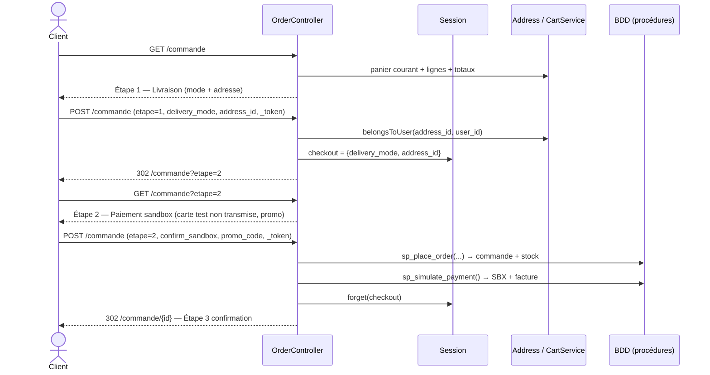

# TuniShop — Parcours client : du panier à la commande

> Ce document décrit le comportement réellement implémenté dans `CartService`, `OrderController` et les vues associées (FR-08 à FR-11, FR-13, RG-01, RG-03, RG-10).

---

## 1. Panier persistant (FR-08, RG-10)

### 1.1 Récupération du panier courant

`CartService::currentCartId()` :

| Situation | Comportement |
|---|---|
| Client connecté | Recherche le dernier panier `status = 'actif'` de l'utilisateur ; le crée sinon |
| Visiteur | Utilise `guest_cart_token` stocké en session (jeton aléatoire de 32 octets) ; crée le panier si besoin |
| Expiration | `expires_at = NOW() + 30 DAY` ; `sp_purge_abandoned_carts()` passe les paniers expirés en `abandonné` puis les supprime après 7 jours |

> Le passage au statut `converti` est fait par `sp_place_order()` : un panier ne peut donc pas être commandé deux fois.

### 1.2 Opérations disponibles

| Action | Route | Service | Garde-fou |
|---|---|---|---|
| Ajouter | `POST /panier/ajouter` | `CartService::add()` | `sp_add_to_cart()` vérifie produit publié, boutique validée et stock |
| Modifier la quantité | `POST /panier/ajouter` (champ `quantity`) | `CartService::updateQuantity()` | `ON DUPLICATE KEY UPDATE` + `trg_cart_items_bu` |
| Supprimer | `POST /panier/supprimer` | `CartService::remove()` | — |
| Consulter | `GET /panier` | `CartService::items()` + `totals()` | Lecture de `v_cart_totals` |

Toutes les routes modifiantes exigent un jeton CSRF valide (`CsrfMiddleware`).

### 1.3 Calcul financier (RG-02 / RG-03)

`v_cart_totals` calcule :

```text
sous-total TTC   = Σ(quantité × prix unitaire TTC)
sous-total HT    = ROUND(sous-total TTC / 1,19 ; 2)
TVA              = ROUND(sous-total TTC − sous-total HT ; 2)
livraison        = 0 si retrait ou sous-total ≥ 100 DT, sinon 8,00 DT
total TTC        = sous-total TTC + livraison − remise éventuelle
```

Exemple du panier de démonstration : 48,00 + 38,00 = **86,00 DT TTC** → HT **72,27 DT**, TVA **13,73 DT**, livraison **8,00 DT**, total **94,00 DT**. Il reste **14,00 DT** avant la livraison offerte.

---

## 2. Tunnel de commande en 3 étapes (FR-11)



### Étape 1 — Livraison

- Deux modes : **domicile** (8 DT, offerts ≥ 100 DT) ou **retrait à l’atelier** (0 DT, Sidi Bou Saïd).
- Le client choisit une adresse enregistrée via `<select name="address_id">`.
- `OrderController::saveDelivery()` vérifie que l'adresse appartient bien au client connecté ; sinon message d'erreur et retour à l'étape 1.
- Les choix sont conservés en session sous la clé `checkout` ; le client peut revenir en arrière avec « ← Modifier la livraison ».

### Étape 2 — Paiement

- Carte de test affichée pour la démonstration (voir [paiement_sandbox.md](paiement_sandbox.md)).
- Code promo facultatif :
  - `ARTISAN5` : −5,00 DT dès 30,00 DT (max 50 utilisations) ;
  - `BIENVENUE10` : −10 % dès 50,00 DT (max 100 utilisations).
- La promotion est validée **côté base** dans `sp_place_order()` (dates, minimum, nombre d'usages) : un code saisi à la main dans l'URL ne peut rien contourner.
- La case `confirm_sandbox` doit être cochée ; sinon retour à l'étape 2 avec un message.

### Étape 3 — Confirmation (FR-13)

- Numéro unique `CMD-YYYY-NNNN` généré par `sp_place_order()`.
- Référence de transaction `SBX-YYYY-NNNNNN` générée par `sp_simulate_payment()`.
- Facture `F-YYYY-NNNN` créée automatiquement par `trg_orders_au` au passage en `payée`.
- Historique des statuts affiché via `order_status_history`.
- Lien « Télécharger la facture PDF » (voir [facturation_pdf.md](facturation_pdf.md)).

---

## 3. Codes promo : exemple chiffré

Panier : 1 × Vase bleu et blanc à 48,00 DT, livraison à domicile.

| Ligne | Montant |
|---|---:|
| Sous-total TTC | 48,00 DT |
| Remise `ARTISAN5` | − 5,00 DT |
| Livraison | + 8,00 DT |
| **Total TTC** | **51,00 DT** |

Sans code promo : 48,00 + 8,00 = **56,00 DT**.  
Avec retrait à l’atelier et `ARTISAN5` : 48,00 − 5,00 + 0,00 = **43,00 DT**.

> La TVA reste calculée sur le sous-total TTC avant remise, conformément à `fn_vat_from_ttc()` et `fn_vat_amount_from_ttc()`.

---

## 4. Sécurité du parcours

| Risque | Protection |
|---|---|
| Modification d'une quantité hors stock | `sp_add_to_cart` + trigger → `PDOException` traduit en message flash |
| Adresse d'un autre client | `Address::belongsToUser()` avant stockage en session |
| Panier converti réutilisé | `sp_place_order` exige `status = 'actif'` |
| Rejeu du POST final | `sp_simulate_payment` refuse un second paiement (`status <> 'en_attente'`) |
| CSRF | Jeton `_token` vérifié sur tous les POST |
| Consultation d'une commande d'autrui | `loadOrderForCurrentUser()` : 404 neutre, même pour un admin non autorisé sur une facture tierce (seul le propriétaire ou un admin peut la télécharger) |

---

## 5. Écrans du prototype couverts

| Écran prototype | Route / vue |
|---|---|
| 04 Panier | `GET /panier` → `cart/index` |
| 05 Checkout | `GET /commande` et `?etape=2` → `checkout/index` |
| 06 Confirmation | `GET /commande/{id}` → `order/confirmation` |
| 07 Espace client | `GET /commande/{id}` + facture PDF |
