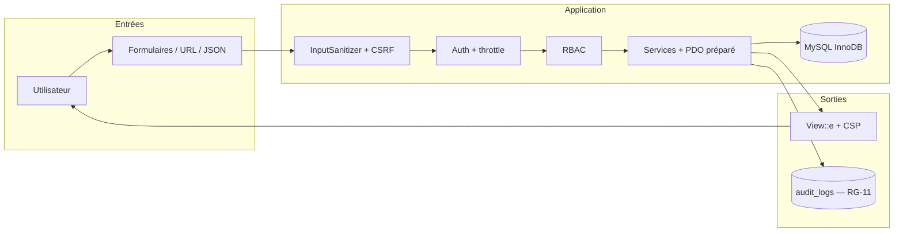

# TuniShop — Livrables Sécurité (matière Sécurité informatique)

| Champ | Valeur |
|---|---|
| **Matière** | Sécurité des applications web — OWASP Top 10, authentification, RBAC, audit |
| **Période** | Sprint 9 (Validation 3 : 24/01/2027, Jury : 25/01/2027) |
| **Référentiel** | **OWASP Top 10 2021**, NFR-01 du cahier des charges, RG-09, RG-11 |
| **Pile** | PHP 8.3, sessions PHP, Argon2id, PDO préparé, CSP, jetons CSRF |
| **Références** | [Socle MVC](../05_backend/README.md) · [E-commerce](../06_ecommerce/README.md) · [BDD](../04_bdd/README.md) |

---

## 1. Fichiers livrés

| Document | Contenu |
|---|---|
| [authentification.md](authentification.md) | Argon2id, politique de mot de passe, rotation de session, verrou après 5 échecs, anti-énumération |
| [rbac.md](rbac.md) | Matrice des rôles, middlewares `auth` / `role:*`, protection des routes et des objets |
| [owasp_top10.md](owasp_top10.md) | Les 10 catégories OWASP 2021, leur traduction dans TuniShop et la preuve de test associée |
| [checklist_securite.md](checklist_securite.md) | Audit de conformité NFR-01, liste des contrôles et secrets à ne jamais versionner |
| [tests_securite.md](tests_securite.md) | 18 scénarios S01–S18, commandes et résultats |

### Code de sécurité ajouté

| Fichier | Rôle |
|---|---|
| `app/Core/Response.php` | En-têtes de sécurité appliqués à **toutes** les réponses (y compris les erreurs) |
| `app/Core/Session.php` | `regenerate()` détruit aussi le jeton CSRF (rotation à la connexion) |
| `app/Services/PasswordPolicy.php` | 8 caractères min. + minuscule, majuscule, chiffre, symbole |
| `app/Services/LoginThrottle.php` | 5 tentatives max / 15 min, verrou de 15 min |
| `app/Services/InputSanitizer.php` | Typage et bornage des entrées (tableaux rejetés, longueurs limitées) |
| `app/Controllers/AuthController.php` | Connexion durcie, messages génériques, audit des échecs et des verrous |
| `app/Middlewares/RoleMiddleware.php` | Journalisation `ACCESS_DENIED` (RG-11) |
| `tests/security.php` | 18 tests de recette sécurité |

---

## 2. Modèle de menace (résumé)



| Actif sensible | Menace | Contrôle principal |
|---|---|---|
| Comptes clients | Force brute, énumération | `LoginThrottle`, message générique, Argon2id |
| Sessions | Fixation, vol de cookie | `session_regenerate_id(true)`, `HttpOnly`, `SameSite=Lax` |
| Commandes / factures | Accès horizontal (IDOR) | Vérification de propriété + 404 neutre |
| Base de données | Injection SQL | Requêtes préparées, `Database::identifier()` en whitelist |
| Navigateur | XSS, clickjacking | `View::e()`, CSP, `X-Frame-Options: DENY` |
| Données bancaires | Vol de carte | Paiement simulé, aucun champ `name`, aucune colonne dédiée |
| Journal d'audit | Fuite de secret | Aucun mot de passe journalisé (test S17) |

---

## 3. Résultat de validation

```powershell
& 'C:\Users\USER\AppData\Local\Composer\composer.bat' test:security
# ou : & 'C:\xampp\php\php.exe' tests/security.php

& 'C:\Users\USER\AppData\Local\Composer\composer.bat' test:all
```

| Suite | Résultat |
|---|---|
| Socle MVC (`tests/run.php`) | **23 PASS / 0 FAIL** |
| E-commerce (`tests/ecommerce.php`) | **15 PASS / 0 FAIL** |
| Sécurité (`tests/security.php`) | **18 PASS / 0 FAIL** |
| Base de données (`database/tests.sql`) | **25 PASS / 0 FAIL** |
| **Total** | **81 PASS / 0 FAIL** ✅ |

---

## 4. État d'avancement

- ✅ Authentification Argon2id, politique de mot de passe, anti-force-brute et anti-énumération.
- ✅ RBAC déclaratif (`auth`, `role:vendeur`, `role:admin`) et contrôle d'appartenance sur les commandes/factures.
- ✅ En-têtes de sécurité sur toutes les réponses, CSP sans script inline, échappement HTML centralisé.
- ✅ Journalisation des accès refusés, des connexions réussies/échouées et des verrous.
- ⏳ Protection supplémentaire recommandée en production : limite de débit par IP derrière un reverse-proxy, 2FA pour les comptes vendeurs/admin, renouvellement périodique des secrets.
