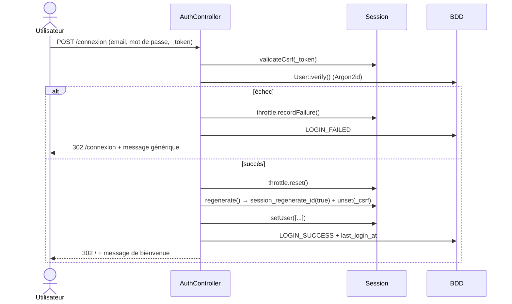

# Authentification et gestion des mots de passe

> RG-09, FR-01 → FR-04, NFR-01, OWASP **A07** (Identification and Authentication Failures).

---

## 1. Hachage Argon2id (RG-09)

`User::createClient()` utilise exclusivement :

```php
password_hash($password, PASSWORD_ARGON2ID)
```

| Propriété | Valeur |
|---|---|
| Algorithme | Argon2id (mémoire-dur, résistant aux GPU/ASIC) |
| Paramètres | `m=65536 Ko`, `t=4`, `p=1` (valeurs par défaut PHP 8.3) |
| Vérification | `password_verify()` — comparateur à temps constant |
| Stockage | Colonne `users.password_hash VARCHAR(255)` |
| Interdiction | Aucun mot de passe en clair en base, dans un log ou dans une vue |

Le test **S09** crée un utilisateur temporaire, vérifie le préfixe `$argon2id$`, contrôle que `password_verify()` réussit et que le clair n'apparaît pas dans le hash, puis supprime l'utilisateur.

> Repli bcrypt mentionné dans le cahier des charges : il n'est pas utilisé par défaut. `password_verify()` sait néanmoins vérifier un hash bcrypt hérité, ce qui faciliterait une migration.

---

## 2. Politique de mot de passe

`PasswordPolicy` impose :

| Critère | Règle |
|---|---|
| Longueur | 8 à 128 caractères |
| Minuscule | Au moins une (`[a-z]`) |
| Majuscule | Au moins une (`[A-Z]`) |
| Chiffre | Au moins un (`[0-9]`) |
| Symbole | Au moins un caractère non alphanumérique |

Exemple valide : `Test1234!` (compte de démonstration). Exemples refusés : `password`, `Ab1!`, `MAJUSCULES123!`.

`PasswordPolicy::score()` renvoie une force de 1 à 4, exploitables ultérieurement dans l'interface d'inscription. Les messages d'erreur sont renvoyés via `ValidationException` et affichés dans la vue `auth/register`.

---

## 3. Limitation des tentatives (brute force)

`LoginThrottle` conserve l'état dans la session du visiteur :

```text
security.login = {
    count:        nombre d'échecs,
    first_at:     horodatage du premier échec,
    locked_until: horodatage de fin de verrou (0 si aucun)
}
```

| Paramètre | Valeur |
|---|---|
| Tentatives maximum | **5** (`LoginThrottle::MAX_ATTEMPTS`) |
| Fenêtre d'observation | 15 minutes (900 s) |
| Durée du verrou | 15 minutes (900 s) |
| Réinitialisation | Succès de connexion, expiration de la fenêtre ou du verrou |

À partir du 5ᵉ échec, toute nouvelle tentative — même avec les bons identifiants — est refusée avec le message « Trop de tentatives de connexion. Réessayez dans N secondes. » et un événement `LOGIN_THROTTLED` est journalisé.

Tests : **S12** (verrou après 5 échecs) et **S13** (bons identifiants refusés pendant le verrou).

> Limite assumée : le compteur est attaché à la session. Un attaquant qui change de session contourne le verrou. En production, il faut ajouter un limiteur par IP et/ou par email dans un cache partagé (Redis) derrière le reverse-proxy.

---

## 4. Anti-énumération des comptes

Deux mesures complémentaires :

1. **Message unique** : « Email ou mot de passe incorrect. », que l'email existe ou non (test **S14**).
2. **Égalisation du temps de calcul** : si l'utilisateur est introuvable, `AuthController` appelle tout de même `password_verify()` sur une empreinte Argon2id fictive (`DUMMY_HASH`). Un attaquant ne peut pas déduire l'existence d'un compte du temps de réponse.

Seuls les événements d'audit diffèrent (`LOGIN_FAILED` avec l'email saisi) et ne sont accessibles qu'à l'administrateur.

---

## 5. Rotation de session et de jeton CSRF



La destruction de l'ancien identifiant de session empêche la **fixation** (OWASP A01). La suppression simultanée de `_csrf` empêche un jeton créé avant l'authentification d'être réutilisé après l'élévation de privilège (test **S06**).

---

## 6. Configuration des cookies

`config/app.php` :

| Option | Valeur | Effet |
|---|---|---|
| `httponly` | `true` | JavaScript ne peut pas lire le cookie (anti-vol XSS) |
| `samesite` | `Lax` | Protection CSRF de premier niveau, navigation conservée |
| `secure` | `false` en local, `true` via `SESSION_SECURE=true` en production | Cookie transmis uniquement en HTTPS en production |
| `lifetime` | 7 200 s (2 h) | Limite la fenêtre d'exploitation d'un cookie volé |
| `name` | `tunishop_session` | Nom explicite (à personnaliser en production) |

Test **S18** : vérifie `httponly`, `samesite` et une durée ≤ 2 h.

---

## 7. Validation des entrées d'authentification

`InputSanitizer` centralise le traitement :

| Méthode | Usage | Garde-fou |
|---|---|---|
| `email()` | `email` | `filter_var(FILTER_VALIDATE_EMAIL)`, minuscules, 190 caractères max |
| `rawString()` | `password` | Aucun `trim()` (un espace peut faire partie du mot de passe), 128 max |
| `label()` | prénom, nom, téléphone, adresse | Suppression des caractères de contrôle |
| `int()` | `product_id`, `quantity`, `address_id` | Refus des tableaux, bornage min/max |

Le test **S16** vérifie qu'un tableau `email[]` est rejeté, qu'un email est normalisé et que des valeurs numériques hors bornes sont ramenées à la limite.

---

## 8. Journalisation (RG-11)

| Événement | Déclencheur | Détails journalisés |
|---|---|---|
| `USER_REGISTERED` | Inscription réussie | Email uniquement |
| `LOGIN_FAILED` | Identifiants invalides | Email saisi **jamais le mot de passe** |
| `LOGIN_THROTTLED` | Session verrouillée | « Verrou temporaire » |
| `LOGIN_SUCCESS` | Connexion réussie | Identifiant + rôle |
| `LOGOUT` | Déconnexion | Identifiant |
| `ACCESS_DENIED` | Rôle insuffisant | Chemin + rôle (voir [rbac.md](rbac.md)) |

Le test **S17** insère un mot de passe distinctive dans un échec de connexion puis vérifie qu'aucune ligne de `audit_logs` ne le contient.

---

## 9. Déconnexion

`AuthController::logout()` (route `POST /deconnexion`, protégée `auth` + `csrf`) :

1. journalise `LOGOUT` si l'utilisateur était connecté ;
2. appelle `Session::destroy()` qui vide le stockage et détruit le cookie de session ;
3. redirige vers `/`.
