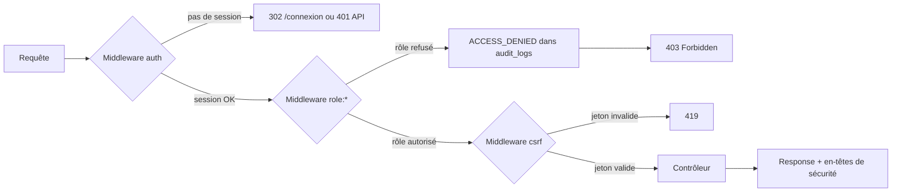

# Contrôle d'accès par rôle (RBAC)

> FR-27, RG-06, OWASP **A01** (Broken Access Control). Le principe du **moindre privilège** est appliqué sur chaque route et sur chaque objet sensible.

---

## 1. Les quatre rôles

La table `roles` du schéma définit :

| Rôle | code | Description | Périmètre |
|---|---|---|---|
| Visiteur | — (aucune session) | Non authentifié | Catalogue, fiche produit, panier |
| Client | `client` | Acheteur inscrit | Commandes, factures, avis |
| Vendeur | `vendeur` | Artisan / commerçant | Boutique, produits, stocks, commandes reçues |
| Administrateur | `admin` | Modération et supervision | Validation des boutiques, tableau de bord global |

> Le rôle est stocké en session lors de la connexion (`AuthController`) et **vérifié côté serveur à chaque requête** : masquer un bouton dans la navigation n'est jamais considéré comme une protection.

---

## 2. Pipeline de middlewares



`Application::bootstrapMiddlewares()` enregistre :

```php
$this->router->addMiddleware('auth', new AuthMiddleware($this->session));
$this->router->addMiddleware('csrf', new CsrfMiddleware($this->session));
$this->router->setMiddlewareFactory(... 'role:vendeur' / 'role:admin' ...);
```

Les middlewares sont déclarés **dans la table de routage**, pas dispersés dans les contrôleurs :

```php
['GET', '/admin/vendeurs', AdminController::class . '@shops', ['auth', 'role:admin'], 'admin.shops'],
['POST','/panier/ajouter', CartController::class . '@add', ['csrf'], 'cart.add'],
```

---

## 3. Matrice des routes protégées

| Route | Visiteur | Client | Vendeur | Admin | Middlewares |
|---|---:|---:|---:|---:|---|
| `GET /`, `/catalogue`, `/produit/{slug}` | ✅ | ✅ | ✅ | ✅ | — |
| `GET /panier` | ✅ | ✅ | ✅ | ✅ | — |
| `POST /panier/ajouter`, `/panier/supprimer` | ✅ | ✅ | ✅ | ✅ | `csrf` |
| `POST /connexion`, `/inscription` | ✅ | ✅ | ✅ | ✅ | `csrf` |
| `POST /deconnexion` | ❌ | ✅ | ✅ | ✅ | `auth`, `csrf` |
| `GET /commande`, `/commande/{id}` | ❌ | ✅ | ✅ | ✅ | `auth` |
| `GET /commande/{id}/facture.pdf` | ❌ | ✅* | ✅* | ✅ | `auth` |
| `GET /vendeur`, `/vendeur/produits`, `/vendeur/commandes` | ❌ | ❌ | ✅ | ❌** | `auth`, `role:vendeur` |
| `GET /admin`, `/admin/vendeurs` | ❌ | ❌ | ❌ | ✅ | `auth`, `role:admin` |
| `POST /admin/vendeurs/{id}/valider` | ❌ | ❌ | ❌ | ✅ | `auth`, `role:admin`, `csrf` |
| `GET /sante` | ✅ | ✅ | ✅ | ✅ | — |

\* Le client ne peut télécharger **que sa propre facture** (contrôle d'appartenance ci-dessous). 
\** Un administrateur n'est pas automatiquement vendeur : il doit posséder le rôle `vendeur` pour accéder à l'espace vendeur.

---

## 4. Contrôle au niveau objet (IDOR)

Le middleware vérifie la **catégorie** d'utilisateur, mais pas l'appartenance d'une ressource. Celle-ci est vérifiée dans `OrderController::loadOrderForCurrentUser()` :

```php
$isOwner = $order !== null && (int) $order['user_id'] === $this->session->userId();
$isAdmin = $this->session->role() === 'admin';
if (!$isOwner && !$isAdmin) {
    throw new NotFoundException('Commande introuvable.'); // 404 neutre
}
```

| Attaque | Résultat |
|---|---|
| Client 3 demande `/commande/1/facture.pdf` (commande du client 2) | **404** — l'existence de la commande n'est pas révélée (test **E15**) |
| Client non connecté demande `/commande/1` | **302** vers `/connexion` (middleware `auth`) |
| Commande encore `en_attente` | **403** — « La facture est disponible après paiement » |
| Adresse d'un autre client soumise au checkout | Rejet par `Address::belongsToUser()` |

---

## 5. Journalisation des refus

Depuis le durcissement sécurité, `RoleMiddleware` appelle :

```php
AuditService::log('ACCESS_DENIED', 'routes', null, $request->path() . ' | role=' . ($role ?? 'anonymous'));
```

avant de lever `ForbiddenException`. Le test **S07** vérifie le couple 403 (client sur `/admin`) / 200 (admin sur `/admin`) ; les tests SQL de la base confirment le comportement des procédures de validation de boutique (RG-06).

---

## 6. Limites et évolutions

| Limite | Évolution recommandée |
|---|---|
| Un seul rôle par utilisateur (`users.role_id`) | Table de jointure `user_roles` pour cumuler `admin` + `vendeur` |
| Aucune vérification de l'état `is_active` après la connexion | Recharger l'utilisateur en base à chaque requête sensible |
| RBAC uniquement (pas d'ABAC) | Ajouter des règles « le vendeur ne voit que ses commandes » via `shop_id` |
| Pas de 2FA | Activer TOTP pour `vendeur` et `admin` (FR-27 renforcé) |
